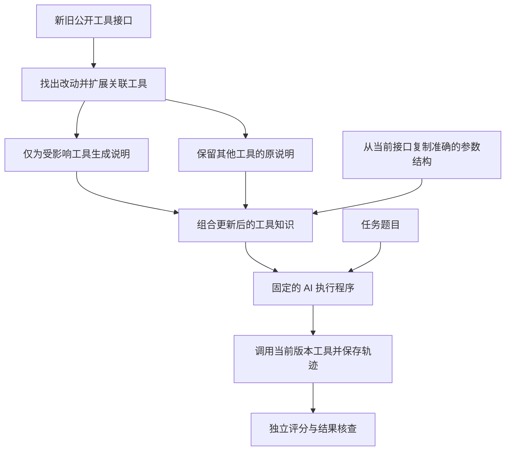

# 企业 AI 工具更新与能力保持

PE6203 Group Project 4：使用官方 MCPEvol-Bench，比较工具升级后“不更新、全部重写、选择性更新”三种办法。系统更新的是工具说明与参数结构，没有重新训练 AI。

企业 AI 原来会用一套工具，工具升级后，旧用法可能失效。我们的程序读取新旧工具接口，识别改动及明确关联的工具，只为受影响部分重新生成说明，其余说明保留。随后让同一个 AI 真正执行任务，保存调用、报错和生成文件，再用独立本地模型评分并核查实际产物。

## 最新结果与证据

- [最新完整报告（PDF，8页）](output/pdf/PE6203_Project4_Final_Report.pdf) · [报告源文稿](docs/REPORT.md)。
- [六人实质工作与集合包](contributions/README.md)：a—f任务、学习内容、文件归属和下载入口；当前为计划分工，实际贡献待成员完成后记录。

- [最终结果与核验](https://github.com/lingenxin3-sketch/pe6203-tool-harness-adaptation/blob/experiments/repeats-20261029/docs/追加实验/交付与核验.md)：三轮概况、可比范围、失败与证据下载。
- [原轮与第二新增轮的可比对照](https://github.com/lingenxin3-sketch/pe6203-tool-harness-adaptation/blob/experiments/repeats-20261029/docs/追加实验/原轮与第二新增轮对照.md)：TF、PE、ECS、成本与逐条来源。
- [安装与复现](docs/REPRODUCTION.md) · [课程要求与证据对照](docs/REQUIREMENTS_EVIDENCE_ZH.md) · [18个任务的产物核查标准](docs/TASK_REVIEW_GUIDE_ZH.md)。

| 轮次 | 已评分 / 计划 | 执行异常 | ECS：不更新 / 全部重写 / 选择性更新 |
|---|---:|---:|---|
| 原轮 final-v1 | 162 / 162 | 4 | 6.280 / 5.239 / 6.332 |
| 第一新增轮 repeat-r2-20261029 | 162 / 162 | 5 | 5.983 / 5.611 / 4.597 |
| 第二新增轮 final-r3 | 162 / 162 | 5 | 4.929 / 5.340 / 6.152 |

共486条已评分记录，均保留失败。第一新增轮有123条跨轮资源清单差异、54组策略间输入差异，单独报告，不能把三轮直接合并成“三次可比重复”。只有原轮与第二新增轮按已披露的实际输入和评分条件提供324条描述性对照：18个不同任务、每组合两次。

该可比对照中，选择性更新的 ECS 轮均值为6.242，不更新5.605、全部重写5.289；选择性更新比全部重写少用65.1%的**更新 token**，但执行、更新和评分三阶段已记录总 token **增加5.6%**。这支持“减少更新工作量”，不证明总成本下降或任务效果普遍更好。ECS 衡量跨版本得分保持，不等于成功率。

最新正式报告已整合三轮独立结果、324条可比对照、恢复保持、分阶段成本和最新案例。原单轮材料作为历史版本保留：[原轮PDF](output/pdf/PE6203_Project4_Report.pdf) · [报告版本说明](output/pdf/README.md) · [原轮结果表](artifacts/final-result-tables.md) · [原轮图表说明](artifacts/figures/README.md)。

## 系统实现

- 三种策略共用执行程序、任务和模型设置；保留原始响应、工具返回、知识变化、文件及失败记录。
- 自研方法识别工具、参数及描述变化，再沿工具名称的明确引用扩展影响范围；隐含操作依赖仍可能漏检。
- Actor/updater 使用 Qwen3-4B-Instruct-2507 Q4_K_M，judge 使用 Qwen2.5-7B-Instruct Q4_K_M，由 llama.cpp b11900 本地运行，无付费 API。
- 官方基准固定为 `888c779a0fe735f612ca62bdd1fdd7c9e6bf8701`；三个版本共32,388个提取文件与官方压缩包逐字节核对一致，见 `artifacts/server-source-audit.json`。

## 运行

从零安装请先按 `docs/REPRODUCTION.md` 准备依赖。在本目录打开 PowerShell 7，运行开发检查：

```powershell
.venv/Scripts/python.exe -m unittest discover -s tests -v
pwsh -NoProfile -File scripts/start-local-model.ps1
.venv/Scripts/python.exe -m tool_adapt run --split development --task-limit 1 --output runs/my-development-run
pwsh -NoProfile -File scripts/stop-local-model.ps1 -Role actor
pwsh -NoProfile -File scripts/start-judge.ps1
.venv/Scripts/python.exe scripts/judge_with_capacity.py runs/my-development-run
.venv/Scripts/python.exe -m tool_adapt analyze runs/my-development-run
```

模型启动后需等待服务就绪再调用。正式完整流程入口（新复现目录、配置已冻结，且停止开发评分模型后运行；本机已有流程运行时不要再次启动）：

```powershell
.venv/Scripts/python.exe scripts/run_full_pipeline.py
```

程序拒绝覆盖已有实验目录。每次运行保留配置、代码摘要、知识状态、更新记录、工具轨迹、模型原始响应与评分理由。

## 方法

工具知识包含可执行工具结构和使用说明。局部修补比较前后契约，找出新增、移除、参数或描述变化；再沿说明中的工具引用扩展影响范围，只重写这些工具的说明。未受影响说明保持原样。全量重写使用相同模型和规则重写全部说明。不更新保留 Early 的旧知识。

两种更新方法均从当前公开工具接口复制准确的结构，语言模型仅生成使用说明，不能擅自更改执行结构。无效说明更新会被拒绝并记入日志，保留此前知识。更新模型不接收任务题目、参考轨迹、变异标注或评分结果。



图中题目只进入执行程序，评分只发生在执行之后；它们都不参与生成工具说明。关联范围依据工具名的明确引用扩展，不能保证识别所有隐含依赖。图示为有效更新路径；生成格式无效时保留此前知识并记录失败。

## 研究边界

- 固定18个任务、三个策略、三个环境版本；测试任务与开发任务分开，不代表整个基准。
- seed=6203、temperature=0 的重复描述相同设置下的执行稳定性，不是新增独立任务或统计显著性证据。Early尚未更新就有分数差异，不能把所有差距归因于更新方法。
- 第二轮输入可见性不同，因此保留该轮并单独报告；原轮与第二新增轮的比较也披露旧客户端检查及JSON序列化差异，详见最终核验页。
- 独立本地7B模型的自动评分有已保存的误判。任务113、117存在调用失败却得高分的情况；评分和真实完成度必须分开看，原分数不修改。
- 原单次依赖扩展组件对照只有6条，不混入主实验重复，也没有证明依赖扩展一定有效。
- 成本只统计已返回并保存用量的调用；中断等未返回调用的成本未知。本地API零计费不含硬件、电费或开发成本，请求累计耗时也不等于完整运行时间。
- 官方评分适配层保留原提示和ECS公式；Windows路径适配只处理加载兼容性，不改工具实现。

## 代码与复现材料

| 路径 | 内容 |
|---|---|
| `tool_adapt/knowledge.py` | 契约变化检测、关联扩展与更新边界 |
| `tool_adapt/mcp_runtime.py`、`agent.py` | 工具连接、目录隔离与共用执行循环 |
| `tool_adapt/official.py`、`experiment.py` | 官方评分接入、实验编排与证据保存 |
| `configs/experiment.json`、`artifacts/inventory/` | 冻结配置及三个版本的工具清单 |
| `docs/REPRODUCTION.md` | 依赖、运行、评分和复现方法 |
| `docs/TASK_REVIEW_GUIDE_ZH.md` | 每个任务应检查的调用和实际产物 |

源码仓库不包含模型权重和完整逐次运行目录；原始记录分别保存在[原轮](https://github.com/lingenxin3-sketch/pe6203-tool-harness-adaptation/releases/tag/v1.0.0)、[第一新增轮](https://github.com/lingenxin3-sketch/pe6203-tool-harness-adaptation/releases/tag/repeat-r2-20261029-evidence)、[第二新增轮](https://github.com/lingenxin3-sketch/pe6203-tool-harness-adaptation/releases/tag/final-r3-evidence)证据发布包中。下载地址、哈希和核验索引见最终结果页。旧发布包保持原样，文档整理不重写历史证据。

历史材料已分类保存在[早期开发归档](archive/development/README.md)和[追加实验进度归档](https://github.com/lingenxin3-sketch/pe6203-tool-harness-adaptation/blob/experiments/repeats-20261029/archive/progress/repeats-20261029/README.md)；归档清单保留原路径与哈希，不混作当前正式运行入口。

## 成员个人成果入口

- [E · LIN GENXIN：失败案例、真实产物与评分核查](contributions/members/E_LIN_GENXIN/README.md)。已分配责任并建立记录目录；实际核查和成果完成情况以本人记录为准，其余成员按分工逐步导入。

## 来源与贡献声明

官方基准：[MCPEvol-Bench](https://github.com/Octobrist/MCPEvol-Bench)。

本项目由AI协助代码开发、文档整理和证据核查。AI辅助核查不等于成员独立复核；六人计划责任见`contributions/`，各包明确共同来源；个人贡献须依据本人实际完成的核查、分析或修改记录，当前不预填完成声明。
