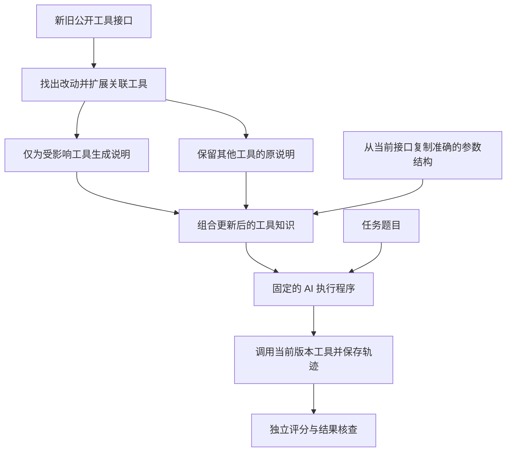

# 企业 AI 工具更新与能力保持

PE6203 Group Project 4 实现：在官方 MCPEvol-Bench 的工具环境变化后，比较不更新、全部重写、局部修补三种策略。目标是在恢复受影响任务的同时保留原有能力，并记录更新开销。

## 一句话讲清楚

企业里的 AI 原来会使用一套工具，工具升级后，旧用法可能失效。这个项目比较三种办法：继续用旧说明、把说明全部重写、只修补改动及相关部分。我们让同一个 AI 真正执行任务，再检查任务结果、工具调用和生成文件，判断哪种办法更有效、更新成本更低。

例如，旧工具只要求填写“任务名称和内容”，升级后又要求“优先级和标签”。保留旧说明的 AI 可能反复报错；更新说明后，AI 才能正确填写。另一方面，把本来没变的说明也全部重写，可能删掉有用细节。

## 先看这些材料

- [完整英文报告](output/pdf/PE6203_Project4_Report.pdf)
- [完整提交包与原始实验记录下载](https://github.com/lingenxin3-sketch/pe6203-tool-harness-adaptation/releases/tag/v1.0.0)
- [结果表](artifacts/final-result-tables.md) · [老师要求与证据对照](docs/REQUIREMENTS_EVIDENCE_ZH.md)
- [六人分工及接下来要做的事](docs/TEAM_PLAN_ZH.md) · [10 分钟演示指南](docs/DEMO_GUIDE_ZH.md)
- [安装与复现](docs/REPRODUCTION.md)

代码仓库不包含大型模型和逐次实验目录。完整证据在上述发布附件的 ZIP 内，不能仅凭下载源代码判断原始实验记录缺失。模型下载地址及校验值见复现说明。

## 项目亮点

1. **真的运行工具。** 不是只有聊天回答；保留工具调用、报错和生成文件。
2. **比较公平、证据可查。** 三种策略使用同一套模型设置和任务，完成 162 条主实验、6 条组件对照，并保留失败。
3. **方法有明确取舍。** 局部修补比全部重写少用 65.1% 的更新 token，但不保证任务分数更高，也没有减少本次实验的总推理 token。
4. **发现评分也会出错。** 有些记录得分很高，却没有生成要求的任务文件；报告用实际证据说明分歧。
5. **全程本地模型。** 无需付费 API；附代码、报告、原始记录和复现步骤。

## 当前状态

代码、正式实验、结果分析和英文报告已完成。全部使用免费本地模型。以下是研究结果，不是课程成绩预测。

- 官方基准固定在 `888c779a0fe735f612ca62bdd1fdd7c9e6bf8701`。
- 已下载原始、iter3、iter5 官方服务包；从包内提取依赖，未改写服务器源码。
- 使用本机 Qwen3-4B-Instruct-2507 Q4_K_M 执行任务和更新知识，随后切换到 Qwen2.5-7B-Instruct Q4_K_M 评分；均通过 llama.cpp b11900 运行，不调用付费 API。
- 已实现工具差异检测、依赖影响扩展、局部更新、全量更新和不更新。
- 已实现 MCP 工具执行、原始轨迹保存、官方评分提示和 ECS 函数接入。
- 正式 162 条主实验及 6 条组件对照均已执行、评分，通过完整性和冻结配置核查；四次主实验执行异常保留在统计中。
- 同一冻结程序的 9 条独立开发验证已完成执行、评分和核查；独立安装环境的 22 项测试通过。开发验证不混入正式成绩。
- 局部修补相对全部重写节省 65.1% 的更新 token；ECS 为 6.33（不更新 6.28，全部重写 5.24）。最后版本的任务得分以不更新最高，不能声称局部修补全面胜出。
- 已逐字节核对三个版本提取的 32,388 个文件，均与官方压缩包相同，详情见 `artifacts/server-source-audit.json`。

## 运行

从零安装请先按 `docs/REPRODUCTION.md` 准备依赖。在本目录打开 PowerShell 7，运行开发检查：

```powershell
.venv/Scripts/python.exe -m unittest discover -s tests -v
pwsh -NoProfile -File scripts/start-local-model.ps1
.venv/Scripts/python.exe -m tool_adapt run --split development --task-limit 1 --output runs/my-development-run
pwsh -NoProfile -File scripts/stop-local-model.ps1 -Role actor
pwsh -NoProfile -File scripts/start-judge.ps1
.venv/Scripts/python.exe scripts/judge_with_capacity.py runs/my-development-run
.venv/Scripts/python.exe -m tool_adapt analyze runs/my-development-run
```

模型启动后需等待服务就绪再调用。正式完整流程入口（新复现目录、配置已冻结，且停止开发评分模型后运行；本机已有流程运行时不要再次启动）：

```powershell
.venv/Scripts/python.exe scripts/run_full_pipeline.py
```

程序拒绝覆盖已有实验目录。每次运行保留配置、代码摘要、知识状态、更新记录、工具轨迹、模型原始响应与评分理由。

## 方法

工具知识包含可执行工具结构和使用说明。局部修补比较前后契约，找出新增、移除、参数或描述变化；再沿说明中的工具引用扩展影响范围，只重写这些工具的说明。未受影响说明保持原样。全量重写使用相同模型和规则重写全部说明。不更新保留 Early 的旧知识。

两种更新方法均从当前公开工具接口复制准确的结构，语言模型仅生成使用说明，不能擅自更改执行结构。无效说明更新会被拒绝并记入日志，保留此前知识。更新模型不接收任务题目、参考轨迹、变异标注或评分结果。



图中题目只进入执行程序，评分只发生在执行之后；它们都不参与生成工具说明。关联范围依据工具名的明确引用扩展，不能保证识别所有隐含依赖。图示为有效更新路径；生成格式无效时保留此前知识并记录失败。

## 公平性与局限

- 所有策略固定模型、解码设置、任务、步数上限和评审规则。
- 测试任务来自官方 201 个选定任务，使用公开原题；开发任务与正式任务分离。
- 为适应本机资源，只选不依赖付费服务的本地工作流，不能声称代表整个基准。
- 官方评分脚本存在固定端口连接和缺失模块导入。适配层从源码提取纯函数并调用原始评分提示及 ECS 实现，不改变评分公式。
- 评审模型为独立的本地 7B 模型，在正式实验前以两个开发案例校准；其评分可靠性仍需要轨迹核查，不是教师官方排名。
- API 账单为零不等于计算没有成本，仍记录 tokens 和时间，硬件与电费不折算为美元。
- `scripts/windows_loader.mjs` 只将 Windows 绝对导入路径转换成文件 URL，不修改工具实现。

## 文件导航

- `tool_adapt/knowledge.py`：变化检测和更新边界。
- `tool_adapt/mcp_runtime.py`：官方工具启动、调用与实验目录隔离。
- `tool_adapt/agent.py`：三种策略共用的固定 Agent 循环。
- `tool_adapt/official.py`：官方评分函数的可移植接入。
- `tool_adapt/experiment.py`：实验编排和证据保存。
- `configs/experiment.json`：任务划分和运行协议。
- `artifacts/inventory/`：三个官方版本的实际工具清单。
- `runs/`：本机真实运行记录，不自动上传。
- `docs/TEAM_PLAN_ZH.md`：六个人的具体工作、验收成果和 29 日前安排。
- `docs/REPRODUCTION.md`：依赖校验、运行、评分和结果核查说明。
- `docs/TASK_REVIEW_GUIDE_ZH.md`：18 个任务分别应该检查什么。
- `docs/DEMO_GUIDE_ZH.md`：不制作 PPT 时如何演示真实记录。
- `docs/REPORT.md`：最终英文报告源文稿；PDF 位于 `output/pdf/PE6203_Project4_Report.pdf`。
- `artifacts/final-result-tables.md`：经核验的完整结果表。
- `docs/REQUIREMENTS_EVIDENCE_ZH.md`：老师要求与实际证据对照。
- `docs/SUBMISSION_GUIDE_ZH.md`：提交包内容与上传说明。

## 来源与贡献声明

官方基准：https://github.com/Octobrist/MCPEvol-Bench

本项目由 AI 协助开发。团队成员应在实际完成验证、分析或修改后记录个人贡献，不应将计划分工写成已完成工作。当前尚未填写任何同学的个人贡献声明。
