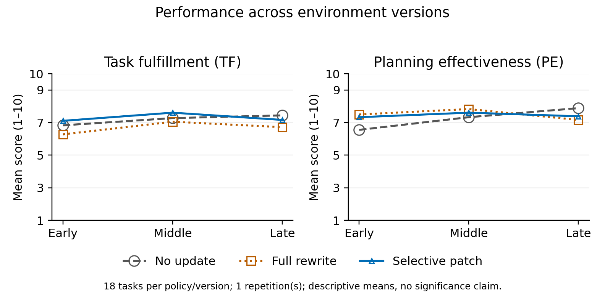

# Dependency-aware selective tool knowledge adaptation

PE6203 Group Project 4 | Original-round experimental report, 27 October 2026

> Historical scope: this report, its PDF and Figure 1 cover final-v1 only (162 main episodes plus 6 supplementary episodes), not the subsequent two rounds. The original PDF remains unchanged. For the completed repeats, input-comparability exclusions and the 324-observation descriptive comparison, see the [final results](https://github.com/lingenxin3-sketch/pe6203-tool-harness-adaptation/blob/experiments/repeats-20261029/docs/追加实验/交付与核验.md). Across the two comparable rounds, selective patching uses 65.1% fewer update tokens but 5.6% more recorded total tokens than full rewrite. No three-round pooled conclusion is supported.

**Abstract.** We evaluate a dependency-aware selective tool-knowledge update against no update and full rewrite on 18 fixed MCPEvol-Bench tasks across three environment versions (162 episodes), with six supplementary component-comparison episodes. All models run locally. Selective patching uses 65.1% fewer adaptation tokens than full rewrite and attains ECS 6.33, compared with 5.24 for full rewrite and 6.28 for no update. It does not consistently improve task scores: no update has the highest Late TF, and dependency expansion shows no reliable benefit in the small comparison. Raw traces reveal stale-parameter failures, regressions after unnecessary rewriting, and overgenerous local judgments. The main finding is a measurable reduction in update work with mixed execution outcomes, rather than universal performance superiority. All 168 formal records are scored and pass protocol/evidence checks; four execution exceptions remain included.

## 1. Problem and contribution

An enterprise agent can fail after a tool upgrade even if its underlying language model has not changed. Tool names, required arguments and usage rules stored in its harness may no longer match the live environment. Rewriting all tool guidance can repair these mismatches, but it also spends computation on unaffected knowledge and may remove useful operational detail.

We implement a dependency-aware selective patch. It compares public tool contracts across versions, identifies changed tools, expands the update set through explicit tool references, and regenerates usage notes only within that set. Executable schemas are copied from the current authoritative interfaces. Unaffected notes are preserved exactly. The method is compared with no-update and full-rewrite baselines using actual MCP servers from MCPEvol-Bench.

The project's contribution is an auditable adaptation pipeline, a narrowly scoped selective method, and a controlled empirical comparison under a no-paid-API constraint. It does not claim a new foundation model or a state-of-the-art benchmark result.

## 2. System and adaptation method

### 2.1 Knowledge representation

Each knowledge state contains a dictionary of executable tool contracts and a dictionary of usage notes. A contract comprises the public tool name, description and input schema. A stable server-derived prefix separates tools with otherwise identical names. Early usage notes are the original descriptions.

At an environment transition, added, removed and modified contracts form the initial change set. A contract is modified if its normalized description or schema differs. The method then examines old and current contracts and previous notes for explicit references to impacted tool names. A referring tool joins the impact set, and this process repeats to a fixed point. Both raw tool names and prefixed aliases are recognized with word boundaries.

This dependency graph is lexical, not a complete semantic dependency model. An unstated prerequisite or a dependency described without the exact tool name may be missed. Conversely, a descriptive mention may expand the patch unnecessarily. The component comparison removes this expansion to isolate its contribution.

### 2.2 Three policies

| Policy | Executable knowledge after change | Usage notes after change |
|---|---|---|
| No update | Keep Early contracts | Keep Early notes |
| Full rewrite | Copy current contracts | Regenerate all scoped notes |
| Selective patch | Copy current contracts | Regenerate changed and explicitly dependent notes; preserve other notes |

Both updating policies use the same local model, updater prompt and output validation. The updater receives only requested tool names and current contracts. It receives no benchmark question, reference trajectory, expected answer, mutation label or score. The prompt requests short notes with exact names and constraints. Validation requires a nonempty string for exactly each requested name; it does not prove semantic correctness of the note. Invalid generated updates are rejected, previous knowledge is retained, and the failure and consumed tokens are recorded.

Copying authoritative schemas prevents generated prose from redefining executable parameters. It does not eliminate semantic omissions in usage guidance or errors in the actor's planning. All policies execute against the actual current environment, including no-update, whose stale calls can therefore fail.

### 2.3 Fixed actor and execution evidence

The shared actor loop allows at most 12 rounds. It receives the same instruction format, task question, resource listing and policy-specific tool knowledge. A single runtime verification opportunity reports actual file changes before the first final answer is accepted; it consumes a normal round and is identical for all policies. When context is too large, whole older assistant/tool groups are pruned while retaining the system instruction, original task and recent context. Pruning is recorded.

Each episode starts with fresh copied official resources and isolated tool state. Tool knowledge, but not task execution state, carries from Early to Middle to Late within a task-policy sequence. The raw request, model response, tool call, tool result, update record and file changes are saved. Deferred judging retains a separate pre-judge actor receipt.

## 3. Benchmark and frozen protocol

### 3.1 Sources and scope

MCPEvol-Bench is pinned to commit `888c779a0fe735f612ca62bdd1fdd7c9e6bf8701`. The three archived server configurations are `original` (Early), `iter3` (Middle) and `iter5` (Late). Eleven local MCP packages and their archived dependencies were extracted without changing their contents. A byte comparison verified all 32,388 extracted archive files across the three environments. A Windows loader converts absolute module import paths to file URLs uniformly; it does not modify server implementations.

The formal subset contains 18 tasks from the official chosen 201-task set:

`9, 28, 103, 105, 113, 117, 139, 267, 273, 274, 278, 283, 386, 389, 393, 403, 411, 416`.

Development tasks 3 and 101 are excluded. Task selection was frozen before formal evaluation and based on local service availability, not final scores. The subset emphasizes file, task, project and memory workflows and is not representative of all 201 tasks. Sixteen of the eighteen questions involve log-analysis workflows, limiting task-family diversity. Questions and benchmark labels are unchanged.

Task-specific tool scope follows the official Early server/tool metadata. Later scope retains surviving named tools and includes newly added tools from those servers. This scope is common to all policies. A task is classified as exposed to change if its scoped current contracts differ from Early; exposure does not prove that the changed tool is indispensable to its solution.

| Environment | Exposed tasks | Unchanged tasks | Tool changes | Parameter changes | Description changes |
|---|---:|---:|---:|---:|---:|
| Middle | 9 | 9 | 3 tasks | 8 tasks | 9 tasks |
| Late | 10 | 8 | 7 tasks | 10 tasks | 9 tasks |

Change categories overlap, so category counts must not be summed as distinct tasks. Cohort membership is stage-specific. Source: run manifest coverage and `artifacts/coverage.json`.

Some official questions mention Ableton logs or a `logs/` directory that is absent from the distributed resource folder used here. We preserve the official resources rather than invent missing logs. Review must distinguish feasible planning/task-creation requests from requests requiring unavailable evidence. Missing resources and fabricated factual claims are documented separately from adaptation failures.

### 3.2 Models and compute

| Setting | Frozen value |
|---|---|
| Actor and updater | Qwen3-4B-Instruct-2507, Q4_K_M |
| Judge | Qwen2.5-7B-Instruct, Q4_K_M |
| Backend | llama.cpp b11900 |
| Hardware | RTX 3060 Laptop GPU, 6 GB VRAM; 16 GB system RAM |
| Temperature / seed | 0.0 / 6203 |
| Maximum response tokens | 2,048 for actor, updater and judge |
| Actor/updater context / actor rounds | 16,384 tokens / 12 rounds |
| Uniform formal judge context | 24,576 tokens (pre-scoring capacity amendment) |
| Repetitions | One per configuration |
| Formal main grid | 18 tasks x 3 policies x 3 versions = 162 episodes |
| Component comparison | Tasks 113 and 416 x 3 versions = 6 additional episodes |

The actor and updater run first; the actor server is then stopped and the larger judge is loaded. All inference is local with no paid API. The judge is fixed across all formal policies. Two development trajectories were used before the formal run to check whether the 7B judge distinguished an absent-file case from a created-file case (TF 6 versus 10). This narrow calibration is not a general reliability guarantee, and grounding scores were still too generous.

A single run is permitted by the assignment under limited compute. Fixed decoding does not make independent episodes identical: workspace paths, tool-generated IDs and implementation-level numerical behavior can differ. We therefore report descriptive differences, not statistical significance or a causal effect established by repeated randomization. Timing is also sensitive to cache reuse and execution order.

## 4. Measurements and verification

Before any formal scoring, an exhaustive vocabulary preflight found four of the 162 main prompts exceeded the original 16,384-token response-reserved budget; the largest estimate was 20,317 tokens. We therefore increased the judge-only context capacity uniformly to 24,576 tokens. This is an explicit pre-scoring protocol amendment, not a performance-driven method change. The actor/updater capacity and source remain frozen; judge weights, rubric, formatter, decoding and 2,048-token answer limit are unchanged. No trajectory is shortened to fit. `configs/judge-capacity.json`, the full preflight and `artifacts/judge-capacity-amendment.json` record the reason and the absence of formal scores when the amendment was made.

TF and PE use the original benchmark's 1-10 judge rubric and aggregation. The upstream evaluator has an unavailable import and an eager connection to a fixed MCP endpoint. Our portability adapter extracts its pure formatting/aggregation functions unchanged, loads its original prompt, and supplies captured current tool contracts. The original trajectory truncation policy is retained. These are rubric-based local scores, not instructor-certified scores.

PE is termed Planning Effectiveness in the course brief; the upstream result field is `planning_and_efficiency_mean`. We retain that original field and rubric. Supplementary Tool-, Parameter- and Description-change cohort results compare captured current contracts with Early. Categories overlap, so their observed scores describe cohort difficulty without isolating the causal effect of a change type.

For task i, let its three TF scores be x(i,E), x(i,M), x(i,L). ECS is the mean across tasks of the within-task mean TF minus its population standard deviation across the three versions. The original benchmark ECS implementation is used; a separate arithmetic calculation checks agreement.

Recovery is reported as the paired TF difference between an updating policy and no-update on the same exposed task and version. Retention is reported as the paired TF difference from the same policy's Early score on unchanged-scope tasks. Positive and negative differences are retained. Tables also report cohort size and improvement/tie/decline counts. Middle and Late cohorts are not conflated.

At Early, all three policies have identical initial tool knowledge and perform no adaptation. Any Early score differences therefore reflect execution or judging variation, not an adaptation benefit. Fixed decoding settings do not by themselves guarantee identical trajectories in separately initialized tool environments. With one repetition, later policy differences remain descriptive; an Early imbalance weakens a causal interpretation of a later gap.

Costs are separated into updating, task execution and judging. We report actual prompt/completion/total tokens, request time and calls, including rejected updates. Cached prompt tokens are visible separately. API charges are zero; electricity and hardware depreciation are not monetized. Request time excludes some harness work, so it is not labeled total experiment duration.

The main aggregator refuses missing, duplicated, invalid or unscored episodes. An independent audit checks frozen source and inventory hashes, unchanged task questions, model settings, retained notes, authoritative updated schemas, preserved actor receipts, and recorded artifact presence. These checks do not by themselves prove semantic task success; representative task outputs are inspected separately.

Three recorded execution exceptions followed output-limited responses with incomplete tool-call arguments; the local template endpoint then rejected those malformed histories. A fourth exception followed a model-service memory-allocation failure, with its distinct evidence discussed in Section 6.3. Each partial trajectory is recovered from incremental events and recorded requests, retaining the original failure receipt and hashes. It is scored as the observed failed run, not replaced by a successful retry or excluded from the denominator. The execution-failure label remains explicit. Whole-episode duration is unavailable for such a terminated run; recorded model-request times are retained. This evidence-handling clarification was applied before formal scoring and changes no agent action or method.

## 5. Formal results

### Main results

| Policy | Early TF / PE | Middle TF / PE | Late TF / PE | ECS |
| --- | --- | --- | --- | --- |
| No update | 6.83 / 6.56 | 7.28 / 7.33 | 7.44 / 7.89 | 6.28 |
| Full rewrite | 6.28 / 7.50 | 7.06 / 7.83 | 6.72 / 7.17 | 5.24 |
| Selective patch | 7.11 / 7.33 | 7.61 / 7.61 | 7.17 / 7.39 | 6.33 |

Each stage mean uses 18 episodes per policy. ECS aligns the same tasks across all three versions.

All policies use identical initial knowledge at Early, with no adaptation. Any Early score gap is execution or judging variation, not an update benefit. One repetition cannot separate every source of variation from later policy differences.

### Middle recovery and retention

| Cohort | Policy | n | TF | Delta vs Early | Delta vs no update |
| --- | --- | --- | --- | --- | --- |
| changed | No update | 9 | 6.89 | +0.00 | +0.00 |
| unaffected | No update | 9 | 7.67 | +0.89 | +0.00 |
| changed | Full rewrite | 9 | 8.44 | +1.67 | +1.56 |
| unaffected | Full rewrite | 9 | 5.67 | -0.11 | -2.00 |
| changed | Selective patch | 9 | 7.89 | +1.22 | +1.00 |
| unaffected | Selective patch | 9 | 7.33 | -0.22 | -0.33 |

Changed = scoped contracts differ from Early. Recovery compares changed tasks with same-version no-update. Retention compares unaffected tasks with the same policy at Early. Negative differences are losses; cohorts and denominators are stage-specific.

### Late recovery and retention

| Cohort | Policy | n | TF | Delta vs Early | Delta vs no update |
| --- | --- | --- | --- | --- | --- |
| changed | No update | 10 | 7.50 | +0.30 | +0.00 |
| unaffected | No update | 8 | 7.38 | +1.00 | +0.00 |
| changed | Full rewrite | 10 | 7.70 | +0.60 | +0.20 |
| unaffected | Full rewrite | 8 | 5.50 | +0.25 | -1.88 |
| changed | Selective patch | 10 | 7.30 | +0.70 | -0.20 |
| unaffected | Selective patch | 8 | 7.00 | -0.75 | -0.38 |

Changed = scoped contracts differ from Early. Recovery compares changed tasks with same-version no-update. Retention compares unaffected tasks with the same policy at Early. Negative differences are losses; cohorts and denominators are stage-specific.

### Results by change category

| Version | Change | Policy | n | TF / PE | Delta vs no update |
| --- | --- | --- | --- | --- | --- |
| Middle | Tool | No update | 3 | 8.00 / 9.00 | +0.00 |
| Middle | Tool | Full rewrite | 3 | 9.33 / 9.33 | +1.33 |
| Middle | Tool | Selective patch | 3 | 10.00 / 10.00 | +2.00 |
| Middle | Parameter | No update | 8 | 7.00 / 7.75 | +0.00 |
| Middle | Parameter | Full rewrite | 8 | 8.50 / 9.12 | +1.50 |
| Middle | Parameter | Selective patch | 8 | 7.62 / 8.12 | +0.62 |
| Middle | Description | No update | 9 | 6.89 / 7.67 | +0.00 |
| Middle | Description | Full rewrite | 9 | 8.44 / 9.00 | +1.56 |
| Middle | Description | Selective patch | 9 | 7.89 / 8.33 | +1.00 |
| Late | Tool | No update | 7 | 7.71 / 8.86 | +0.00 |
| Late | Tool | Full rewrite | 7 | 8.43 / 9.00 | +0.71 |
| Late | Tool | Selective patch | 7 | 8.71 / 9.00 | +1.00 |
| Late | Parameter | No update | 10 | 7.50 / 8.60 | +0.00 |
| Late | Parameter | Full rewrite | 10 | 7.70 / 7.90 | +0.20 |
| Late | Parameter | Selective patch | 10 | 7.30 / 7.60 | -0.20 |
| Late | Description | No update | 9 | 7.22 / 8.44 | +0.00 |
| Late | Description | Full rewrite | 9 | 7.78 / 8.33 | +0.56 |
| Late | Description | Selective patch | 9 | 7.33 / 7.78 | +0.11 |

Compared with Early using captured authoritative evaluation tools: Tool = added/removed names; Parameter = changed schema on surviving names; Description = changed description on surviving names. Categories overlap; cohort difficulty is descriptive and cannot isolate a mutation effect.

A lower score identifies a harder observed cohort, not the causal effect of that change type. Empty categories have no score. Category counts must not be summed as unique episodes.

### Adaptation cost

| Policy | Calls | Total tokens | Request seconds | Token saving vs full |
| --- | --- | --- | --- | --- |
| No update | 0 | 0 | 0.00 | 100.0% |
| Full rewrite | 36 | 104,472 | 359.32 | 0.0% |
| Selective patch | 19 | 36,449 | 123.08 | 65.1% |

Totals include both environment transitions and rejected update calls. No-update has no adaptation generation, but that alone says nothing about task quality. Token savings are relative to full rewrite, not an overall utility score.

### Execution and judging cost

| Policy | Component | Calls | Total tokens | Request seconds |
| --- | --- | --- | --- | --- |
| No update | agent | 426 | 3,007,538 | 27204.20 |
| No update | judge | 54 | 406,669 | 1673.41 |
| Full rewrite | agent | 403 | 2,682,307 | 11202.20 |
| Full rewrite | judge | 54 | 397,788 | 3141.77 |
| Selective patch | agent | 405 | 2,985,921 | 5773.46 |
| Selective patch | judge | 54 | 408,974 | 4177.25 |

All recorded API charges are USD 0 because inference is local. Hardware and electricity are not monetized. Request time is not whole-experiment duration; cache reuse, hardware and execution order affect timing.

### Dependency-expansion component comparison

| Task | Version | TF on / off | Delta TF | PE on / off | Notes on / off |
| --- | --- | --- | --- | --- | --- |
| 113 | Middle | 4.00 / 10.00 | -6.00 | 10.00 / 10.00 | 6 / 2 |
| 416 | Middle | 10.00 / 10.00 | +0.00 | 10.00 / 10.00 | 4 / 1 |
| 113 | Late | 10.00 / 10.00 | +0.00 | 10.00 / 10.00 | 9 / 5 |
| 416 | Late | 4.00 / 10.00 | -6.00 | 5.00 / 10.00 | 4 / 1 |
| 113 | Early | 4.00 / 10.00 | -6.00 | 10.00 / 10.00 | 0 / 0 |
| 416 | Early | 10.00 / 10.00 | +0.00 | 10.00 / 10.00 | 0 / 0 |

On = the main selective method; off = the predeclared selective variant without reference expansion. Early performs no updates. The six pairs are supplementary, with two predeclared tasks and one repetition; they are not a second full benchmark.

### Fixed-budget execution diagnostics

| Policy | Step-limit episodes | Length-limited replies | Calls with pruning | Rejected updates |
| --- | --- | --- | --- | --- |
| No update | 7 | 2 | 11 | 0 |
| Full rewrite | 6 | 1 | 6 | 0 |
| Selective patch | 4 | 1 | 16 | 0 |

Episode counts and model-response counts have different denominators. An output reaching its length limit does not always abort an episode. Context pruning keeps original instructions and the task; full raw histories remain saved. These common resource limits can mediate observed policy differences.

### Recorded execution exceptions

4 terminal execution exception(s) remain included in the scored grid.

| Task | Policy | Version | TF | PE |
| --- | --- | --- | --- | --- |
| 117 | Full rewrite | Late | 9.00 | 10.00 |
| 273 | No update | Late | 7.00 | 4.00 |
| 278 | Selective patch | Late | 4.00 | 2.00 |
| 393 | Selective patch | Early | 7.00 | 5.00 |

Original failure receipts and incremental traces are preserved. Scoring a failed trace is not a retry or a claim that task execution completed successfully.

### Interpretation of the measured results

Selective patching has the highest observed ECS (6.3325), but its margin over no update is only 0.0521. Its Middle TF is 7.61, versus 7.28 for no update and 7.06 for full rewrite. At Late, no update leads with TF 7.44, followed by selective at 7.17 and full rewrite at 6.72. This mixed ranking does not establish that adapting is always better. Early differences occur before any update and are an important warning against attributing every later gap to the method.

On change-exposed tasks, selective patching's paired TF gap against no update is +1.00 in Middle (n=9) and -0.20 in Late (n=10). Full rewrite's corresponding gaps are +1.56 and +0.20. On unaffected tasks, selective's change from its own Early score is -0.22 in Middle and -0.75 in Late. Full rewrite's corresponding changes are -0.11 and +0.25. Thus the data do not support a blanket retention advantage for selective patching, even though its absolute unaffected-cohort scores exceed full rewrite's. Paired task-level outcomes and all denominators are retained in `runs/final-v1/analysis/paired-comparisons.json`.

For the selective method, the Parameter cohort has the lowest observed TF among change categories in Middle (7.62 versus Tool 10.00 and Description 7.89) and Late (7.30 versus Tool 8.71 and Description 7.33). Parameter changes are therefore the hardest observed cohort for this method. This is not an isolated mutation experiment: categories overlap, tasks differ, and the same claim does not hold for every policy. Task 113 supplies direct evidence of a specific required-parameter mismatch; cohort means alone do not explain its cause.

Selective updating generates 19 requests and 36,449 tokens, versus 36 requests and 104,472 tokens for full rewrite: 68,023 fewer tokens, a 65.1% reduction. Its measured update request time is 123.08 seconds versus 359.32 seconds (65.7% lower). These are adaptation-only savings. Including recorded actor, updater and judge requests, selective uses 3,431,344 tokens and full rewrite 3,184,567; selective therefore does not save total inference tokens in this run. Hardware/cache/order effects prevent treating the large actor-time differences as algorithmic speedups. Unknown costs from two interrupted judge requests are excluded from returned-call accounting.

The dependency-expansion comparison does not validate a performance benefit. Expansion rewrites more notes in every changed pair, while its TF is lower in two of four changed pairs and tied in the other two. Task 113 already differs by six TF points at Early, when both variants do no updating; that pair cannot isolate the causal contribution of expansion. Task 416 has equal Early scores but worse Late TF with expansion. These negative and ambiguous results are retained, not used to tune and rerun the formal method. A larger repeated comparison is needed before recommending expansion over direct change detection alone.

Figure 1. Each point averages 18 formal episodes on the original 1-10 scale. There is one repetition; no confidence interval is implied. Exact plotted values are supplied in `artifacts/figures/figure-data.json`.

## 6. Failure analysis

Analysis distinguishes under-update, over-update, actor planning errors, server faults, missing resources and judge disagreement. A failed episode is not automatically an adaptation failure. Each reported example must identify the changed or preserved knowledge, relevant calls, observed errors and actual outputs.

### 6.1 Under-update: stale planning parameters, task 113

The user requests a structured plan for a log-analysis dashboard. Early `request_planning` requires `originalRequest` and `tasks`. Late additionally requires `splitDetails`, `priority` and `tags`. No-update retains the Early schema.

| No-update Late action | Actual result |
|---|---|
| Create the dashboard project | Project state is saved |
| Plan with only the Early required fields | Server rejects three missing fields |
| Add `splitDetails`, then retry three times in total | `priority` and `tags` remain missing; all three calls fail |
| Retrieve/complete tasks for the unregistered request | Tool payloads report `Request not found` |
| Final answer | Blames the task system; the task-plan file was never created |

Selective Late exposes the current required fields and supplies them on the first planning call. Its three calls create a project, register the plan and retrieve the next task. The saved `tasks.json` contains five tasks covering parsing, categorization, aggregation, interface design and integration/testing. Their completion and approval flags remain false: this is successful plan setup, not a completed dashboard or obtained human approval.

The validation errors establish the stale-parameter mechanism directly. This no-update example is the limiting case of missed knowledge updates, not evidence that the selective patch itself omitted these fields. It also does not isolate dependency expansion from ordinary schema replacement; the component comparison addresses that question. Full raw paths and details are in `docs/CASE_113_REVIEW.md`.

The fixed local judge nevertheless gives no-update Late task 113 TF 10 and PE 10, stating that all seven requirements were met while acknowledging registration failures. The saved project-state file is not a registered task-plan file. Thus the observed schema repair cannot be presented as a TF recovery from this already-maximal baseline score. We preserve the score and report the disagreement between the rubric judgment and concrete task-registration evidence. This further limits conclusions drawn from score differences alone.

### 6.2 Over-update: rewriting unchanged guidance, task 28

The task asks for a comparison of two log files and saved to-do tasks. Its scoped Middle contracts are unchanged. Full rewrite nevertheless regenerates all three notes, omitting the original setup note's explicit statement that a missing source file can be created. The actor had created the task file at Early; in Middle it follows this unsuccessful sequence:

| Full-rewrite Middle action | Actual result |
|---|---|
| Read both log files | Contents returned successfully |
| Add tasks before initializing a source, with an invented ID | Source not found |
| Initialize each input `.txt` log as the task source | Both rejected; the tool supports `.md`, `.json` and `.yml` |
| Final answer | Incorrectly claims the requested task file cannot be created; no output file exists |

No-update Middle and selective Middle instead initialize `anotation_path/markdown/tasks.md`, use the returned ID, and write tasks. This is an observed regression associated with an unnecessary rewrite of unchanged knowledge. The lost file-creation statement is a plausible contributor, but the rewritten note still instructs initialization, and the actor disobeys that instruction too. A single comparison does not prove that one omitted sentence caused the outcome.

The retained runs are not perfect: some task content treats a database error absent from today's log as definitely unresolved. Selective Late also fails to create the file despite preserving the task-management notes. These counterexamples show why preserving a note is not a guarantee of preserving behavior. Details and raw paths are in `docs/CASE_28_REVIEW.md`. Both examples are real, fully scored formal-run records. An output-file review of all 18 episodes for tasks 28 and 113 is saved in `runs/final-v1/analysis/artifact-review.json`; file existence alone is not proof of content correctness.

### 6.3 Errors outside adaptation

Tool errors require content inspection: task 113 returns two `Request not found` payloads with `isError: false`, in addition to four explicitly flagged validation errors. The simple flagged-error diagnostic therefore cannot be treated as a complete failure count. Original results remain unchanged for common-protocol judging.

An additional execution exception affects selective Early task 393, where no adaptation has occurred. One recorded model response requested six tool calls; the saved evidence includes the resulting tool messages, a project-state file and a memory file, but no final answer. The response was not length-truncated. A later template-only check of the saved history returned HTTP 200 without replaying the task or generating another answer. Although the episode's generic exception omits its inner cause, the backend log provides stronger evidence: the saved response's exact token counts and timings match server task 302261, immediately followed by a `bad allocation` error on the next request, task 303364. This identifies an immediate model-service memory-allocation failure; the underlying RAM, VRAM or allocator cause is not established. It is not attributed to selective updating or to the truncation mechanism seen in other incidents. The matched log excerpt, original failure receipt and partial artifacts remain in the evidence package, and the failed attempt remains included in scoring.

The scoring service also encountered a CUDA out-of-memory error after 39 completed judgments. The client connection closed without a returned result for the next record. Original service and scoring logs and the hashes of the 39 saved records were archived. Restarting the same server configuration allowed the pending record to be scored; all 39 earlier record hashes remained unchanged. No actor episode or completed judgment was rerun. Tokens and duration for the unreturned judge request are unavailable in the client cost records, so measured judge cost understates total infrastructure effort by that unknown amount. This interruption is distinct from the four actor execution failures. Evidence is retained in `artifacts/incidents/judge-oom-after39`.

A second scoring interruption occurred after 57 completed judgments: the service returned HTTP 500 with `decode() failed: bad allocation`. A same-configuration restart successfully scored the pending no-update Middle task 117. Hash checks confirmed all 57 earlier scored records were unchanged, and the restarted service reported the same generation settings. Both interruptions are preserved; their unreturned request costs are unavailable. The immediate allocation errors are established, but the underlying allocator, memory-pressure or driver causes are not isolated. See `artifacts/incidents/judge-allocation-after57`.

### 6.4 Judge disagreement: task 117

The fixed judge assigned full-rewrite Late task 117 TF 9 and PE 10 despite an execution exception and an empty final answer. Its three calls are `analyze_task`, `plan_task` and `split_tasks`; the last returns an unterminated-string error. No task file is created, and no archive-search call is present, although the question requests both task decomposition and retrieval of reusable past tasks. Planning text exists in arguments, but the judge's assertion that nine of ten sub-goals were fulfilled is not substantiated by successful registration or retrieval. This is an apparently overgenerous completion assessment, not evidence of recovery. We retain the original score in all aggregates, report the execution failure separately, and do not invent a replacement score. High PE also does not imply task completion. The preserved calls and review are in `docs/CASE_117_JUDGE_REVIEW.md`.

### 6.5 Why low selective scores do not automatically prove missed updates

Selective Middle task 113 successfully registers five tasks, retrieves the next one and saves the plan, yet receives TF 4: the judge counts only the retrieved task as fulfilled. This is a different interpretation from the generous no-update Late judgment discussed above. The plan is not an implemented dashboard, but treating its five registered tasks as absent also misrepresents the saved evidence. The low score remains unchanged and cautions against interpreting the component comparison as a clean causal test.

Selective Late task 416 receives TF 4 and PE 5. Its trajectory shows cross-system identifier confusion: after splitting tasks in one tool system, it tries to mark or fetch tasks from a different, unregistered request, producing three `Request not found` payloads. It then supplies a past deadline, which the current server rejects. The regenerated note explicitly says a supplied deadline must be in the future, so this particular error is actor noncompliance, not a missed rule update. A subsequent valid planning call registers five tasks. The actor marks and approves a task without an intervening human message and without producing implementation code; saved approval flags therefore do not establish real human approval or completed implementation. Only task-state files are created, and the run reaches its budget without a final answer. Evidence: `runs/final-v1/repeat-0/selective_patch/iter5/416/result.json` and its saved files. This failure shows that correct tool knowledge does not ensure correct workflow execution.

## 7. Discussion and limitations

The supported conclusion is narrower than a universal performance win: selective patching reduces measured note-generation work and avoids rewriting unaffected notes, but does not consistently improve execution quality or retention. Its ECS advantage over no update is small, its Late TF is lower, and dependency expansion is not supported by the supplementary comparison. These outcomes favor cautious evaluation of selective updates rather than an assertion that the most elaborate updater is best.

For an enterprise deployment, a useful next step would be to require concrete post-update checks such as valid calls and persisted outputs, because fluent plans and high rubric scores can coexist with failed registration. A future study should compare direct-change-only and dependency-expanded patches across more task families and repeated runs, audit judge agreement against human assessments, and measure actual task outcomes. These are proposed extensions, not completed experiments. The present implementation can miss implicit dependencies, generate incomplete guidance, or have little effect when the main obstacle is planning or missing resources.

The study is limited by its local subset, quantized small actor, single repetition, machine-specific timings and imperfect local judge. Grounded execution evidence and transparent negative results are essential to interpreting any apparent gain. No model weights are fine-tuned, and no benchmark answer labels are modified.

## 8. Reproduction and contribution disclosure

See `docs/REPRODUCTION.md` for installation, hash verification, execution, judging and aggregation. The frozen configurations, raw results and audit scripts accompany the report. Model and server binaries are obtained from the sources and hashes in `artifacts/dependency-lock.json`.

After formal scoring, the final frozen workflow was run on development task 3 under all three policies and versions. All nine episodes completed execution and scoring, with no terminal execution exceptions, and passed the recorded-invariant audit. Core source hashes match the formal run. This verifies the final execution-to-scoring workflow; it is excluded from formal performance statistics and does not constitute another benchmark repetition. A separately installed Python environment also passed all 22 tests. The checks and package evidence are local, not a claim of reproduction on a second machine.

AI assisted code and document preparation. Proposed allocations of work are not evidence that named students have completed those activities. Actual contributions must be recorded after the work is performed. Slides are outside the current requested deliverables.

## Sources

1. Course brief: *PE6203 Group Project 4 - Tool Harness Adaptation under Environment Change* (provided document).
2. MCPEvol-Bench source at the pinned commit: https://github.com/Octobrist/MCPEvol-Bench/tree/888c779a0fe735f612ca62bdd1fdd7c9e6bf8701
3. Official server archive source: https://huggingface.co/datasets/anonymous2233/evol-servers
4. Actor GGUF source: https://huggingface.co/unsloth/Qwen3-4B-Instruct-2507-GGUF
5. Judge GGUF source: https://huggingface.co/Qwen/Qwen2.5-7B-Instruct-GGUF
6. Local backend release: https://github.com/ggml-org/llama.cpp/releases/tag/b11900
